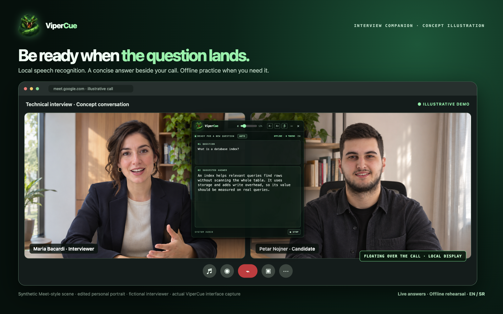
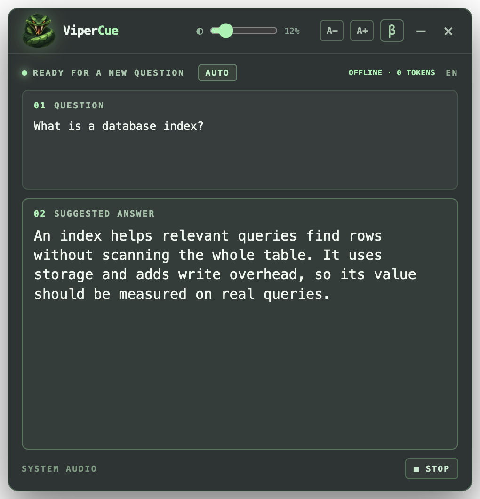
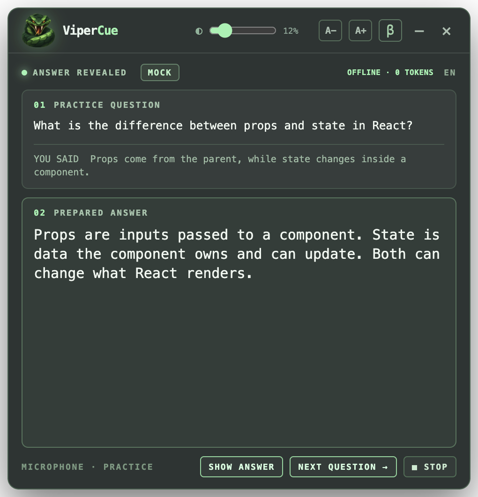
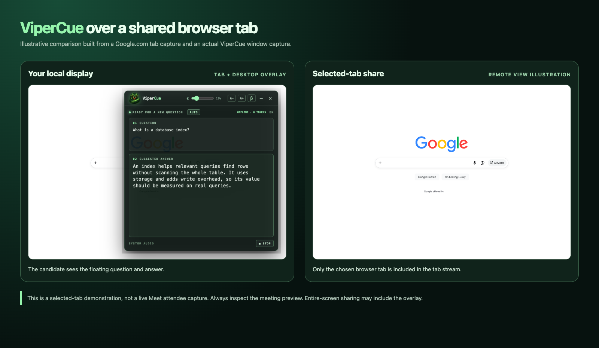

# ViperCue

**A desktop interview companion and offline practice deck.** ViperCue is a floating Electron window for macOS. It transcribes English or Serbian speech locally, keeps the current question visible, and shows a short answer. The interface starts in English; Serbian is available for both the interface and speech recognition.

Created by [@nokibuzz](https://github.com/nokibuzz).




The scene above combines an edited creator portrait, a fictional AI-generated interviewer and an actual app capture. It is a concept illustration, not a recording of a real meeting. The viper illustration crouches and lunges on the setup screen and pauses during a live session. The macOS app icon is static. Motion stops when the system requests **Reduce Motion**, in line with [Apple's motion guidance](https://developer.apple.com/design/human-interface-guidelines/motion) and [W3C's reduced-motion technique](https://www.w3.org/WAI/WCAG22/Techniques/css/C39.html).

| Live answer | Offline practice |
| --- | --- |
|  |  |

## Two ways to use it

**Live** captures meeting audio from Meet or Teams, detects questions after speech pauses, and displays a concise answer. It skips common introductions and incidental speech. You can also hold Shift to record one question or double tap Shift to record until the next press. The previous answer stays visible until a new question is ready. Answer sources are **Offline** by default, the user's own Codex CLI login, or an OpenAI API key entered for that session. Speech recognition stays local in all three cases.

**Mock** is a microphone based interview rehearsal. Pick a topic or a mixed deck, then click **Start Mock**. ViperCue asks a question from [16 English and Serbian prompts](src/data/mock-interview.md), transcribes your spoken response, and reveals a prepared reference answer when you press **Show Answer** or say “show answer.” Say “next question” or use the button to continue. Saying “start MOC” or “start mock” repeats the active question. Mock always uses the bundled Markdown deck and **zero AI answer tokens**.

The [live offline library](src/data/interview-questions.md) has 47 bilingual entries across HR, Java, React, Python, .NET, DevOps, front-end, data analytics and systems. Answers are starting points for practice; personal examples should use the candidate's real experience.

## Install

The current macOS package targets **Intel x64**. Download the [ViperCue 0.8.2 preview DMG](https://github.com/nokibuzz/vipercue/releases/download/v0.8.2/ViperCue-0.8.2.dmg), open it, drag **ViperCue.app** into Applications, and launch it. The app includes the local Whisper binary and multilingual model, so the installed app needs no account or API key for Offline and Mock. This build is unsigned; macOS may require **Open** from Finder's context menu. Grant Microphone access for Mock and system audio capture permission for Live when prompted.

To build from a checkout on macOS:

```bash
xcode-select --install
brew install cmake
npm install
npm start
```

The first start downloads and builds [whisper.cpp](https://github.com/ggml-org/whisper.cpp) and its multilingual base model if they are missing. That one-time step needs internet access and can take several minutes. You also need Node.js 20 or newer and Xcode Command Line Tools. To create a DMG and ZIP:

```bash
npm run dist:mac
```

The package appears in `dist/`, which Git ignores. A fresh checkout does **not** include a model binary. The [preview release](https://github.com/nokibuzz/vipercue/releases/tag/v0.8.2) contains the distributable DMG.

## First session

1. Choose **English** or **Srpski** for the interface and separately for spoken language.
2. Choose **Mock** for microphone practice or **Live** for meeting questions. Offline is the default Live answer source.
3. In Mock, pick a topic and click **Start Mock**. Answer aloud, reveal the prepared answer, then advance.
4. In Live, select system audio for a browser meeting. Use automatic detection, or manual Shift capture when you want explicit control.
5. Open **History & analytics** after a session. The optional β panel shows usage during a session; its money and quota fields depend on what the selected provider exposes.

Window transparency, answer text size, and answer area are adjustable. Local JSON history records question text, timing, model and token counts. Mock practice is summarized separately from Live answer usage. The [automatic question rules](docs/automatic-mode.md) are deterministic and may miss or misclassify unusual introductions; **Start questions** is available when an interviewer transitions without a clear phrase.

## Screen sharing



This image compares an actual Google.com tab capture and an actual ViperCue window capture. It **illustrates selected-tab sharing**; it is not a capture from a live Meet attendee. [Google Meet lets the presenter select a tab, a window, or an entire screen](https://support.google.com/meet/answer/9308856?co=GENIE.Platform%3DDesktop&hl=en-419). Share a specific tab or browser window and inspect the meeting preview. Electron's content protection is enabled, but [Electron warns that macOS ScreenCaptureKit can still capture protected windows](https://www.electronjs.org/docs/latest/api/browser-window/#winsetcontentprotectionenable-macos-windows); **entire-screen sharing may show the overlay**.

The [visual walkthrough](portfolio/README.md) includes setup, practice, Live and dashboard screenshots. The Google.com sharing illustration hides browser account links and avatar. The promotional scene uses the creator's edited portrait with permission.

## Privacy and release status

No API key, Codex credential, email address, or interview transcript is committed to this repository. API keys entered in the app are held in memory for the active session. Codex mode invokes the installed user's own CLI login. Offline and Mock make no AI answer request. Interview history stays in the app's local user-data directory; users should review it before sharing diagnostics or backups.

This is a working macOS x64 preview, with automated unit tests and a local speech-to-practice smoke test. It is not yet signed or notarized and needs broader device and meeting-platform testing before a production claim. The package is currently `UNLICENSED`; choose a license before allowing reuse.
