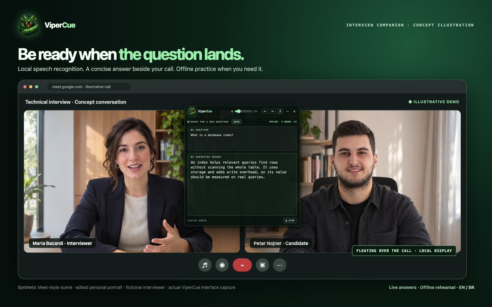
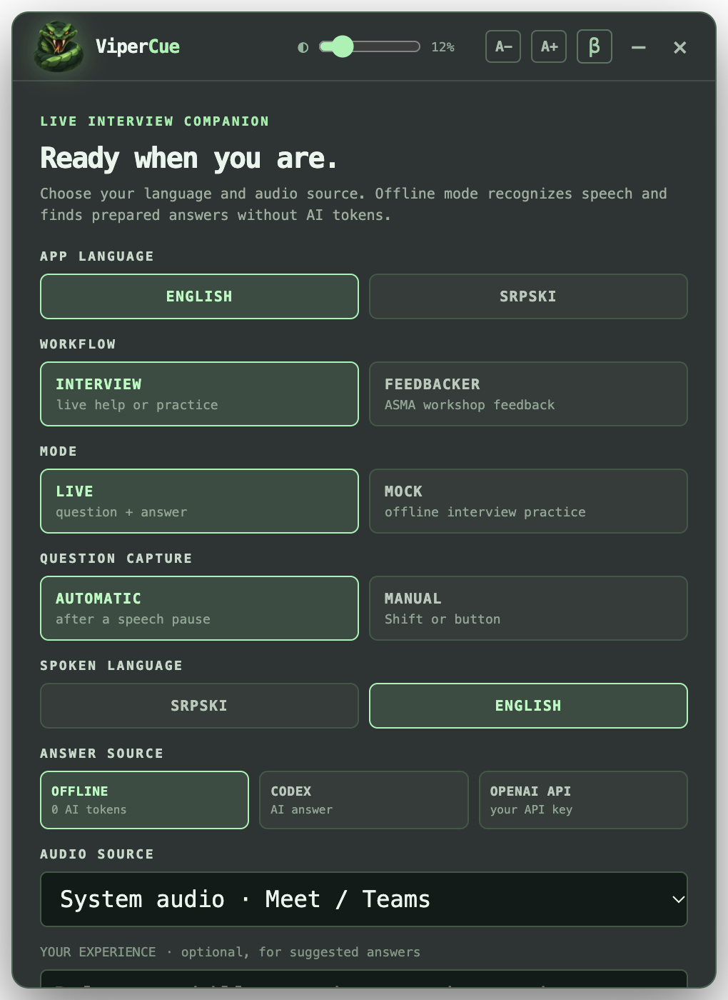
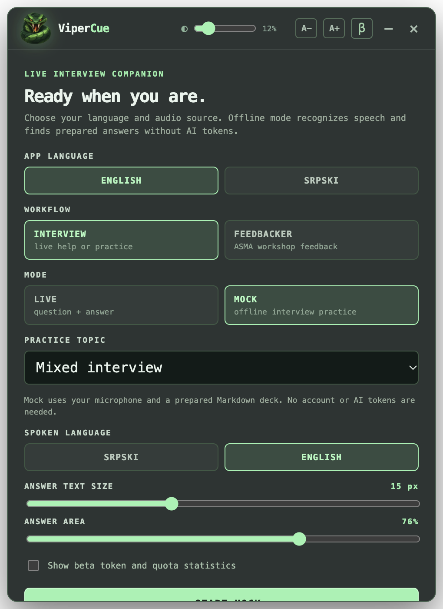
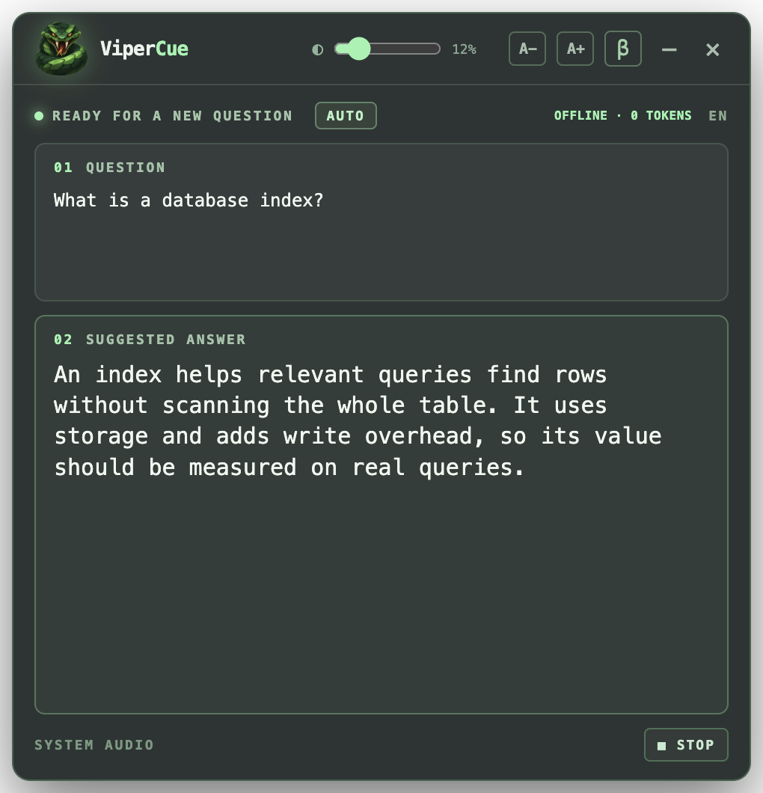
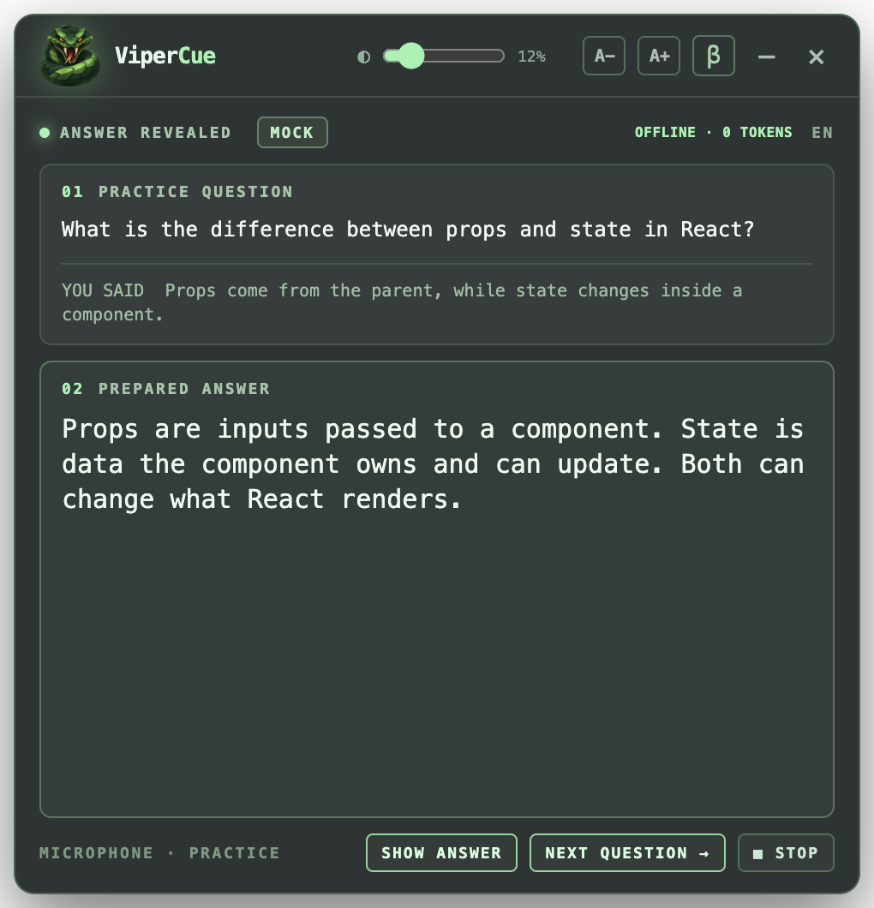
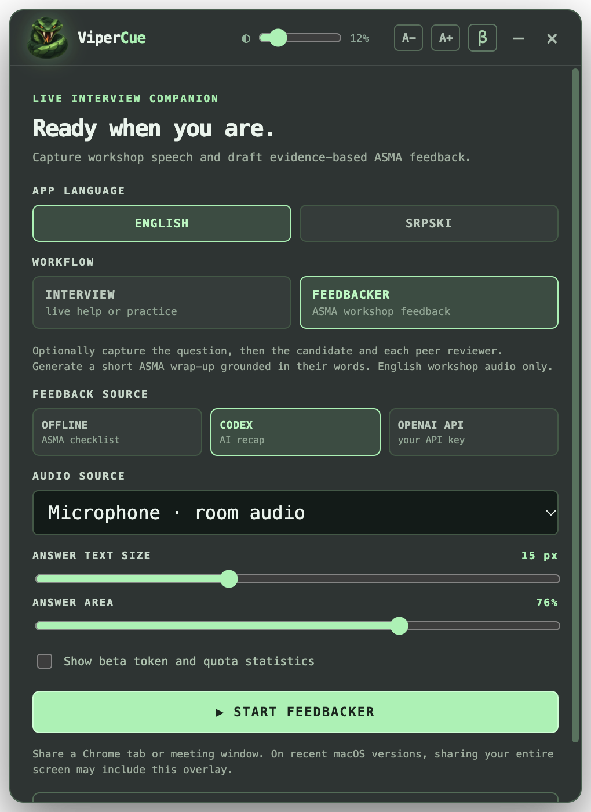
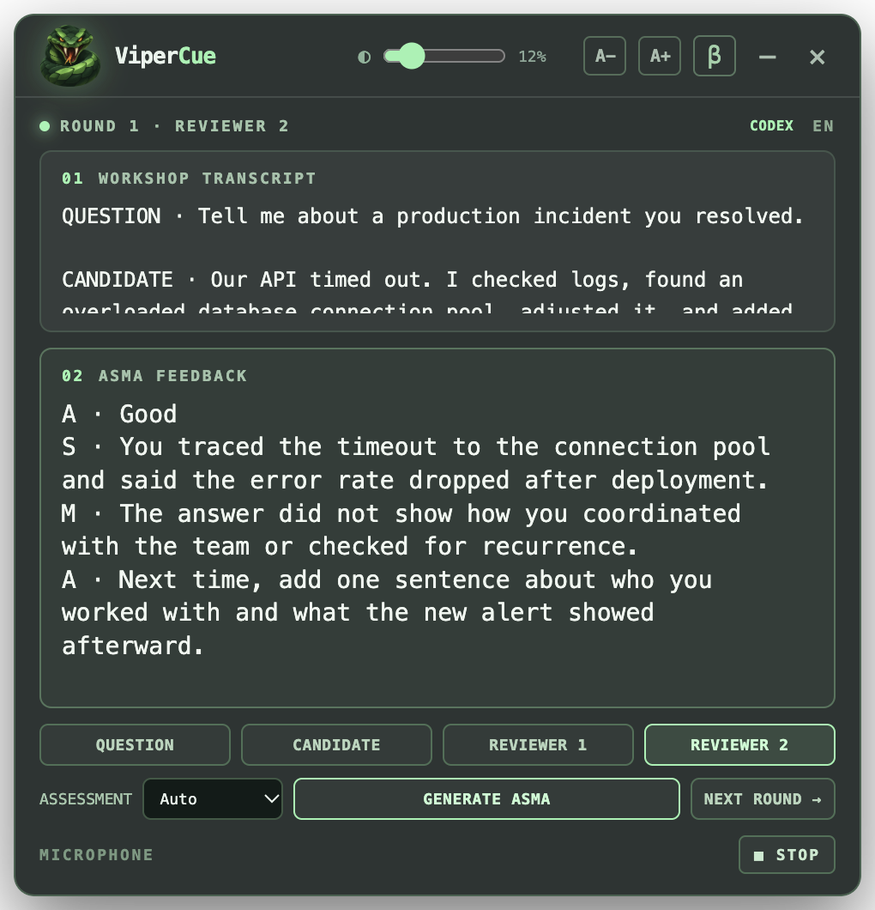
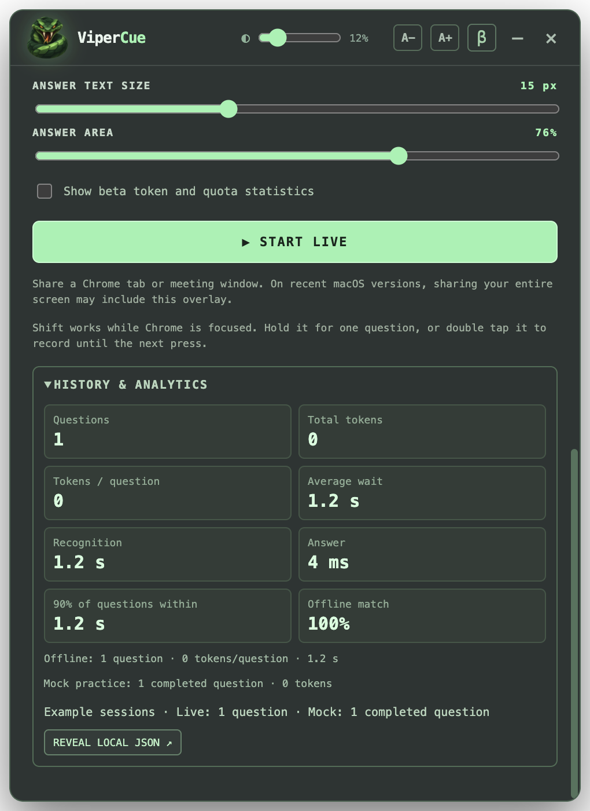
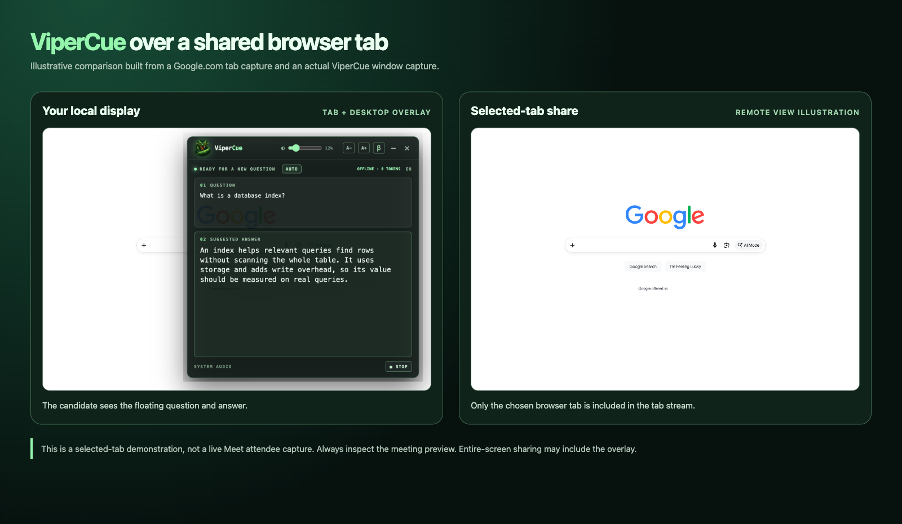

# ViperCue · visual walkthrough

ViperCue is a floating macOS interview companion with an animated, coiled viper mark. English is the default interface; Serbian is available for the interface, transcription, questions, and prepared answers.

## Meet-style concept scene

This is a composed product illustration, not a recording of a Meet call. It shows a fictional AI-generated interviewer labeled Maria Bacardi, an edited portrait supplied by the creator labeled Petar Nojner, and an actual ViperCue interface capture floating across the center of the call. The original personal photo is not part of this repository. The editable layout is [meet-promo.html](meet-promo.html).

## Start a session

| Live setup | Mock setup |
| --- | --- |
|  |  |

Live answers can use a local Markdown library, the user's own Codex CLI login, or an API key entered at runtime. Mock uses the microphone and the [bilingual practice deck](../src/data/mock-interview.md) with zero AI answer tokens.

## See the question and answer

| Live example | Mock practice example |
| --- | --- |
|  |  |

These are interface captures populated with demonstration content. They are not recordings of a real interview. In Mock, click **Start Mock**, answer aloud, use **Show Answer**, then **Next Question**. Voice commands include “show answer,” “next question,” and “start MOC” to repeat the current prompt.

## Run an English feedback workshop

| Feedbacker setup | Sample ASMA recap |
| --- | --- |
|  |  |

Select the active speaker as the interview question, candidate answer, and two peer reviews are spoken. Then press **Generate ASMA** for a short facilitator recap. These captures contain synthetic dialogue; no real workshop transcript appears in this repository. Codex uses the installed user's login; Offline shows a checklist rather than a generated assessment.

## Review a session

The dashboard image uses illustrative values. In use, the app computes the live answer count, token totals, average and 90th-percentile wait, recognition and answer times, plus separate practice and Feedbacker summaries from local history.

## Share a selected browser tab

This comparison combines a real Google.com tab screenshot with an actual ViperCue window screenshot. It is an **illustration of selected-tab sharing**, not a live Meet attendee capture. Google account controls, links, and avatar were hidden in the source tab image. Select a tab or window and inspect the meeting preview. Entire-screen sharing on macOS may include the overlay even with Electron content protection; see the [Electron API note](https://www.electronjs.org/docs/latest/api/browser-window/#winsetcontentprotectionenable-macos-windows).

The editable source for this comparison is [share-comparison.html](share-comparison.html).
